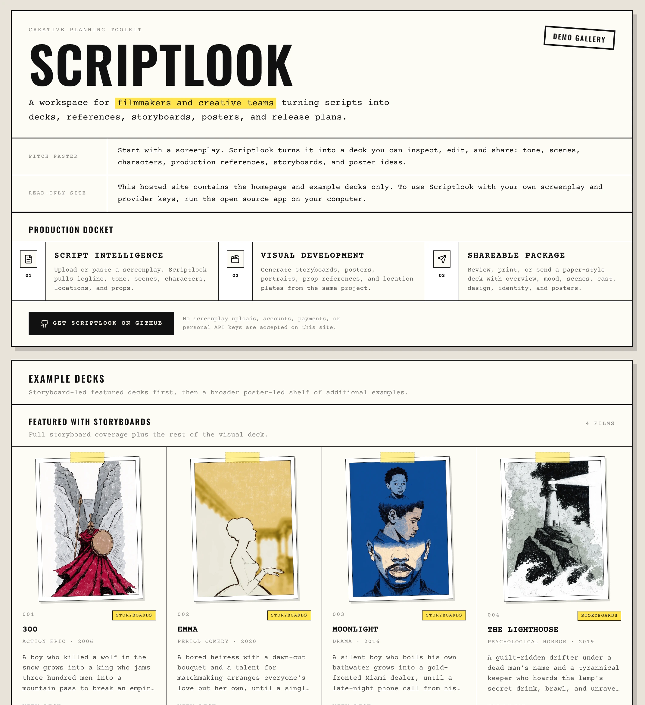

<h1>Scriptlook</h1>

Turn a screenplay into a visual deck. 
Tone, characters, locations, storyboards and posters from one script, with your own API keys.

  
  
  
  

<a href="https://www.scriptlook.com">See the demo gallery</a>

Scriptlook turns a screenplay or treatment into an editable visual deck, for students, first-time filmmakers and small teams building an early pitch.

- A PDF, FDX or TXT script becomes tone, cast, locations, storyboards and posters.
- It runs on your own API keys, with no account to create.
- You can edit any section in the browser, then print the deck or save it as a PDF.

It doesn't do budgets, call sheets or production management. Every section, with examples, is in [docs/what-it-makes.md](docs/what-it-makes.md).

## How it works

Your OpenAI or Claude key turns the screenplay into structured scenes, characters, locations and props. Claude, OpenAI, DeepSeek or Gemini then write the sections you pick, and a fal.ai key, if you add one, generates portraits, locations, props, storyboards and posters. Regenerate any part you don't like, then print, save or share the deck.

## Privacy

There's no database or analytics. Your keys and the active project stay in the browser's `localStorage`, PDFs are parsed in the browser, and generation sends the extracted text only to the providers you picked. Check their pricing and data policies before sending material you don't own. The hosted site at scriptlook.com shows example decks only and accepts no uploads or keys.

## Install

You need Node.js 20.9 or newer and an OpenAI or Claude key. Run `npm install` and `npm run dev`, open http://localhost:3000, and add your keys in **Settings**. A TMDB key is optional, for poster thumbnails of film and soundtrack references. This product uses the TMDB API but is not endorsed or certified by TMDB.

Before a pull request, run `npm test`, `npm run typecheck`, `npm run lint` and `npm run build`. See [CONTRIBUTING.md](CONTRIBUTING.md) and [SECURITY.md](SECURITY.md).

---

[MIT](LICENSE)

Made by [santiagoalonso.com](https://santiagoalonso.com)
