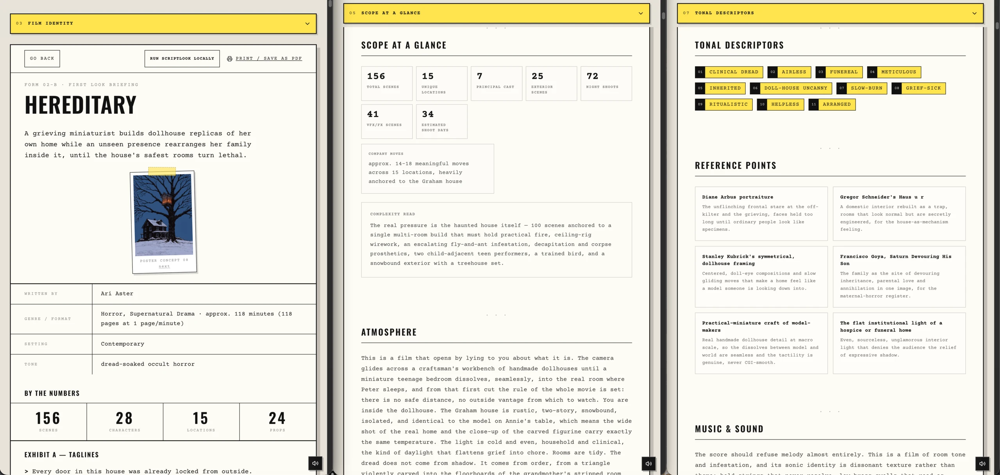
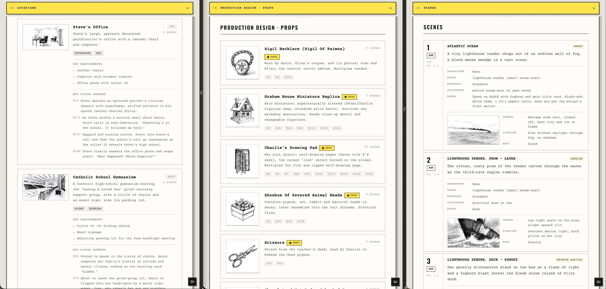

# What Scriptlook makes

Every part of a Scriptlook deck, with examples from the demo gallery. The short version is the [README](../README.md).

## Film identity and tone

The deck starts with the film's identity: logline, synopsis, themes, atmosphere, tonal descriptors, visual references, music and sound, color palette, title treatment, and poster directions. Together, these sections make the screenplay's tone easier to see and discuss.

[Explore the complete Hereditary example deck](https://www.scriptlook.com/app/demo/hereditary)

## Characters and casting

Scriptlook identifies each character, their role in the story, and their relationships, then develops casting and wardrobe references. The point is to make each character visually clear early enough to shape the rest of the deck.

  
  
  

*Casting references from [Emma](https://www.scriptlook.com/app/demo/emma#cast).*

## Locations and production design

Locations, props, wardrobe, set requirements, continuity details, and practical risks all come from the same screenplay breakdown. This keeps the visual ideas tied to what the film will actually need.

  
  
  

*Production-design references from [The Lighthouse](https://www.scriptlook.com/app/demo/the-lighthouse#props).*

## Scenes and storyboards

The scene map connects page ranges, characters, locations, props, emotional beats, production flags, and visual briefs. Optional storyboard frames add camera, lighting, composition, and mood references to each scene.

  
  
  

*Storyboard frames from [300](https://www.scriptlook.com/app/demo/300#scenes).*

## Posters and presentation

Poster concepts reduce the film to one clear image and idea. The deck stays editable in the browser, so you can review, print, save it as a PDF, or share it as a working creative package.

  
  
  

*Poster directions from [Moonlight](https://www.scriptlook.com/app/demo/moonlight#poster-concepts), [Emma](https://www.scriptlook.com/app/demo/emma#poster-concepts), and [Aftersun](https://www.scriptlook.com/app/demo/aftersun#poster-concepts).*
